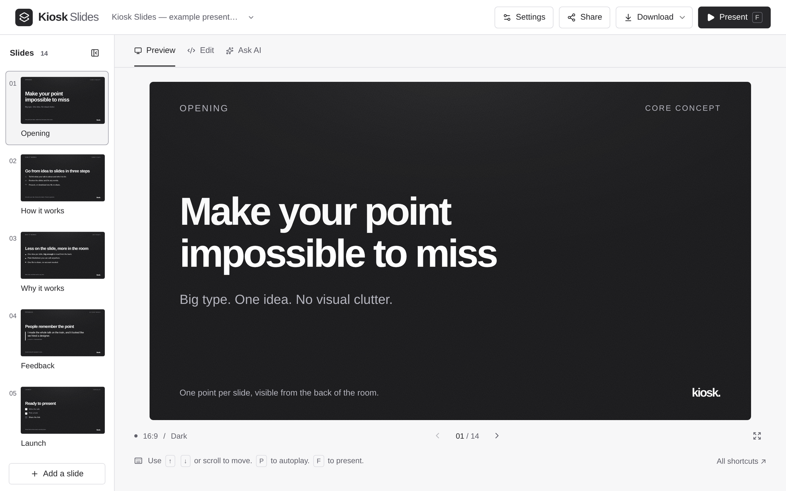

# Kiosk Slides

**Slides made to be seen. Ready in seconds.**

Tell an AI what you want to say. Get a clean, finished presentation back, and put it on the screen. No dragging boxes, no picking layouts, no nudging text. Just your point, big and clear.

**[Try it at kiosk-slides.com](https://kiosk-slides.com)**: free, no account, works in your browser. Or add the [skill](#install-the-skill) to your AI and ask it for a presentation.



## Install the skill

Install it once for each agent you use. It is then available in new projects on your computer. Claude Code and Codex keep separate plugin installs, so run both sets of commands if you use both.

### Claude Code

At the Claude Code prompt, run these commands one at a time:

```text
/plugin marketplace add evgenius1424/kiosk-slides
/plugin install kiosk-slides@kiosk-slides
```

Create or change a presentation with the command:

```text
/kiosk-slides Make a 6-slide presentation about our Q3 results.
```

### Codex

In your terminal, run:

```bash
codex plugin marketplace add evgenius1424/kiosk-slides
codex plugin add kiosk-slides@kiosk-slides
```

In Codex, name the skill in your request: "Use kiosk-slides to make a 6-slide presentation about our Q3 results."

Need another agent? See [more installation options](#more-installation-options).

## Why "Kiosk"

A kiosk screen has one job: to be read at a glance, from a distance, by someone who is busy. It plays in a lobby, on a meeting-room TV, or in a shared window on a call, and nobody gets to lean in and squint.

That is the bar every Kiosk Slides presentation is built to clear. One idea per slide. Headlines that fill the screen. Text sized for the last row of the room and still sharp after screen sharing has squeezed it. If a slide can't be read from across the room, it isn't a kiosk slide.

## Seconds, not hours

Most slide tools give you a blank canvas and a hundred controls. Then you spend the afternoon aligning things.

Kiosk Slides takes the opposite view: **manual layout is obsolete.** You bring the content, the AI shapes it, and every slide comes out balanced because every piece was designed to work together:

- Headlines that size themselves to fit, so a one-word slide fills the screen and a long one still lands.
- Steps, numbers, before-and-after, tables, charts, flows, code, images and buttons, each tuned to look right next to the others.
- Spacing, color and type that are already decided, so there is nothing to fiddle with and nothing to get wrong.

Describe your talk, read the result, press Present. That is the whole workflow.

## Built for screen sharing

Slides today are mostly seen through a video call or on a TV across a table. Kiosk Slides is designed for that, not for a printed handout:

- **Screen-share safe mode** turns every transition into a quick, flat fade that stays crisp when the picture is compressed. Press `S` while presenting.
- **Calm transitions**: Gentle, Crossfade, Slide, or none at all.
- **Big text sizes**, up to a hero setting where every heading fills the screen.
- **Autoplay and looping**, so a presentation can run on its own on an unattended screen.

## What you get

- **Ask AI.** Chat with ChatGPT using your own ChatGPT plan, and watch the slides appear. Sign-in runs on your own computer, so your account never touches a server.
- **Free AI draft.** On the hosted site, describe your talk and get one AI-written draft a day, while a small shared monthly allowance lasts. Your request is sent to Anthropic to write it, and the site keeps no copy. When the allowance runs out, copy the prompt into any AI instead.
- **Use any AI.** Copy the ready-made prompt into Gemini, ChatGPT, Claude or anything else, then paste the slides it writes.
- **Six themes**: dark, light and studio, plus paper (a warm serif page), poster (the tone fills the slide) and marker (key words in a colored pill). Each comes in black and white or with a Violet, Coral, Teal or Amber tone tuned to it.
- **Fonts** including Inter, Figtree, Bricolage Grotesque, Space Grotesk, Archivo Expanded and Golos Text, each with Cyrillic letters.
- **Your brand** in the corner of every slide, or nothing at all.
- **Present anywhere**, including from a phone held sideways, with swipe and tap.
- **Many presentations**, saved in your browser and one click apart.
- **Works offline and installs as an app.** After one visit the site opens, edits, presents and downloads with no connection. Only the AI features need the internet.
- **One-file download.** Every presentation downloads as a single HTML file with its images and fonts inside. It opens in any browser, works offline, and needs nothing installed. Pick PDF instead for email and chat: one page per slide, with the same look.
- **Share by link.** The link carries the whole presentation. Nothing is uploaded: the slides live in the link itself.

## Skill for your AI

The same thing, without the website. The **kiosk-slides** skill in [`skills/`](skills/kiosk-slides) lets an AI agent turn a conversation, notes or a document into a presentation, check it against the format, and render it to the same single-file HTML the site downloads. You get both files: the Markdown to edit, and the HTML to present. It also renders or re-themes a presentation you already have, with your choice of theme, tone, font, text size and transition.

It shares the site's own renderer, so a presentation looks exactly the same wherever it was made. It needs Node 18 or later.

### More installation options

The `npx skills` route copies the skill into your current project. Use one installation route per agent.

<details>
<summary><strong>GitHub Copilot</strong> (CLI and VS Code)</summary>

```bash
copilot plugin marketplace add evgenius1424/kiosk-slides
copilot plugin install kiosk-slides@kiosk-slides
```

In VS Code, run **Chat: Install Plugin From Source** and enter `https://github.com/evgenius1424/kiosk-slides`.

</details>

<details>
<summary><strong>Gemini CLI</strong></summary>

```bash
gemini skills install https://github.com/evgenius1424/kiosk-slides.git --path skills
```

Re-run it to update.

</details>

<details>
<summary><strong>Cursor, OpenCode, Windsurf, Amp and others</strong></summary>

```bash
npx skills@latest add evgenius1424/kiosk-slides
```

Update with `npx skills@latest update`.

</details>

In Claude Code, use `/kiosk-slides` to start the presentation workflow. In other agents, name `kiosk-slides` in your request.

## Run it yourself

```bash
git clone https://github.com/evgenius1424/kiosk-slides
cd kiosk-slides
pnpm install
pnpm dev
```

Open http://127.0.0.1:3000. Running it on your own computer is what turns on Ask AI with your ChatGPT plan.

The **Add to your AI** panel, which walks people through installing the skill, shows locally and on preview deployments. Set `SKILL_INSTALL=on` to show it in production, or `off` to hide it everywhere.

The AI buttons under each slide (Shorter, Make it visual and the rest) are hidden for now. Set `SLIDE_AI=on` to show them.

The free AI draft is off unless `AI_DRAFT_ENABLED=true`. It also needs `ANTHROPIC_API_KEY`, an Upstash Redis database (`UPSTASH_REDIS_REST_URL` and `UPSTASH_REDIS_REST_TOKEN`, or the `KV_REST_API_*` pair Vercel adds), and a random `IP_HASH_SALT`. Redis holds only hashed visitor keys and counters: one draft per visitor a day, 20 a day in all, and a monthly budget, with `SET ai-draft:enabled 1` as the switch that turns drafts on and `DEL ai-draft:enabled` as the one that stops them.

The presentation format is described in [FORMAT.md](FORMAT.md), with a full example in [public/example.md](public/example.md).

## How it was made

Kiosk Slides is a one-person product built with AI coding agents. Evgenii decides what to build and what to leave out, and the agents write most of the code. A few choices shaped it:

- **A point of view first.** No manual layout, on purpose. Every feature is weighed against one question: does it make slides easier to read from across a room?
- **Saying no.** Speaker notes, presenter view, timers and progress bars were all considered and turned down, because they pull attention from the slide.
- **Markdown as the product.** A plain text format AI writes well, people can fix by hand, and every path renders the same way: the site, the downloaded file and the agent skill share one renderer, and tests keep them identical.
- **Private by default.** No accounts and no server storage. Presentations live in your browser, and a shared link carries the whole presentation inside it.
- **Checked before shipping.** The riskiest flows, like two open tabs or pasting over your work, are modeled in [TLA+](specs/) to find data loss before users do.

## Made by

Kiosk Slides is the idea and work of [Evgenii Glinskii](https://www.linkedin.com/in/evgenii-glinskii-869805a8) ([@evgenius1424](https://github.com/evgenius1424)). If it helped you, a star on GitHub or a note on LinkedIn means a lot.

## License

Kiosk Slides is open source under the [MIT License](LICENSE). The bundled fonts are under the SIL Open Font License, listed in [public/fonts/LICENSE.md](public/fonts/LICENSE.md).

Contributions are welcome. Start with [CONTRIBUTING.md](CONTRIBUTING.md), and report security problems privately as described in [SECURITY.md](SECURITY.md).
